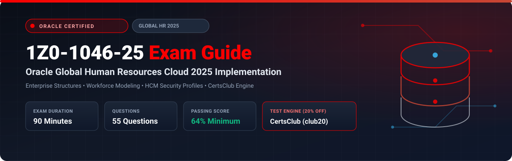

  

# Oracle Global Human Resources Cloud 2025 Implementation Professional (1Z0-1046-25) Exam Study Guide & Practice Test Resource Portal

[-f80000?style=for-the-badge&logo=oracle&logoColor=white)](https://education.oracle.com/)
[-f80000?style=for-the-badge&logo=oracle)](https://education.oracle.com/)

[-28a745?style=for-the-badge&logo=shield)](https://www.certsclub.com/oracle/)

---

## 1. Exam Overview & Candidate Profile

The **Oracle Global Human Resources Cloud 2025 Implementation Professional (1Z0-1046-25)** exam certifies that a consultant has the comprehensive skills required to configure and implement Oracle Fusion Cloud Global HR. Tested competencies include setting up enterprise hierarchies (Legal Employers, Business Units, Divisions), configuring workforce structures (Jobs, Positions, Grades, Grade Ladders), managing worker lifecycle transactions, configuring security profiles, and designing custom business rules in HCM Experience Design Studio.

Passing 1Z0-1046-25 earns the **Oracle Global Human Resources Cloud 2025 Certified Implementation Professional** credential.

### Target Candidate Profile & Career Roles
* **Oracle HCM Cloud Functional Consultants & Solution Leads**
* **HR Systems Architects & Business Process Analysts**
* **Enterprise People Technology Specialists**

---

## 2. Key Exam Specifications

| Parameter | Official Specification |
| :--- | :--- |
| **Exam Code** | 1Z0-1046-25 |
| **Exam Title** | Oracle Global Human Resources Cloud 2025 Implementation Professional |
| **Associated Credential** | Oracle Global Human Resources Cloud 2025 Certified Implementation Professional |
| **Duration** | 90 Minutes |
| **Number of Questions** | 55 Questions |
| **Passing Score** | 64% |
| **Question Format** | Multiple Choice (Single and Multiple Select) |
| **Delivery Vendor** | Pearson VUE / Oracle University Online Remote Proctoring |
| **Recommended Practice Test Engine** | **[1Z0-1046-25 Practice Test - CertsClub](https://www.certsclub.com/oracle/)** (Coupon: `club20` for 20% off) |

---

## 3. Official Blueprint & Exam Domain Breakdown

| Domain Code | Domain Title | Weighting | Key Competencies Covered |
| :--- | :--- | :---: | :--- |
| **1.0** | **Enterprise Structures Setup** | **20%** | Enterprise, Legal Employers, Business Units, Reference Data Sets (SetID), Divisions, Departments. |
| **2.0** | **Workforce Structures Configuration** | **22%** | Job families and jobs; Position synchronization and position hierarchy; Grades, grade rates, and grade ladders; Locations. |
| **3.0** | **Worker Lifecycle Management** | **22%** | Hiring workflows, Pending Workers, Employee and Contingent Worker records, Transfers, Promotions, Global Transfers, Terminations. |
| **4.0** | **Security Profiles & Role-Based Access** | **18%** | Person Security Profiles, Organization Security Profiles, Position Security Profiles, Data Roles, Security Console. |
| **5.0** | **Workflow Approvals & Experience Design Studio** | **18%** | Transaction Console, BPM approval rules, HCM Experience Design Studio (Autocomplete rules, conditional field visibility). |

---

## 4. Scenario-Based Demo Question & Explanation

### Question 1: Position Synchronization
**Scenario:** A company enables Position Synchronization for its global workforce. An HR specialist updates the Department on an existing Position. 

What happens to the employees currently assigned to that position?

A) Employee assignments update immediately and automatically in real time.  
B) The HR specialist must manually update each employee record.  
C) Run the **Synchronize Person Assignments from Position** process to cascade the changes to incumbent worker records.  
D) Position updates cannot change employee assignments once created.  

**Correct Answer:** **C**

**Detailed Explanation:**
* In Oracle Fusion HCM, updates made to an existing position require running the **Synchronize Person Assignments from Position** scheduled process to synchronize the changed attributes (Department, Location, Job, etc.) across all worker assignments linked to that position.

---

## 5. Recommended Preparation Strategy & Practice Testing Engine

1. **Practice Enterprise & Workforce Configurations:** Set up multi-country legal employers, SetIDs, and grade ladders in a test environment.
2. **Practice with Full-Length Mock Exams:** Use **[CertsClub Oracle 1Z0-1046-25 Practice Tests](https://www.certsclub.com/oracle/)**.
   * Comprehensive questions covering lifecycle transitions, security profiles, and position sync.
   * Enter discount coupon code **`club20`** at checkout on [CertsClub](https://www.certsclub.com/oracle/) for an immediate 20% discount.

---

## 6. Official Documentation & References

* [Oracle Fusion Cloud Global Human Resources Documentation](https://docs.oracle.com/en/cloud/saas/human-resources/)
* [Oracle University 1Z0-1046-25 Exam Details](https://education.oracle.com/)
* [CertsClub 1Z0-1046-25 Practice Engine](https://www.certsclub.com/oracle/)
